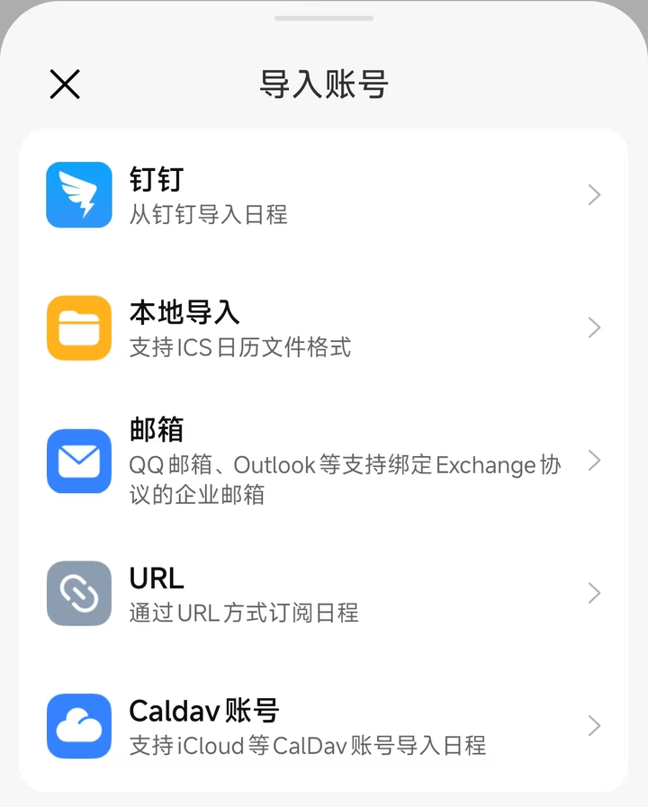
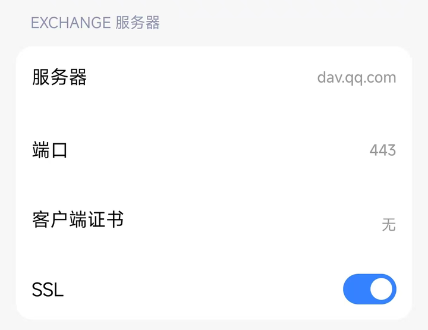
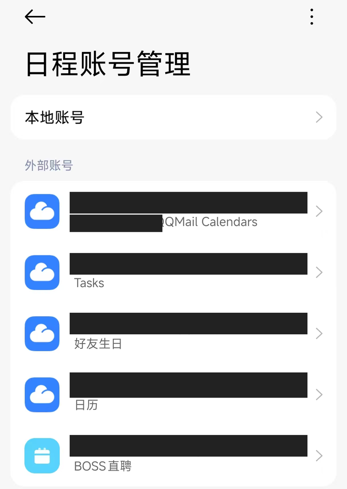
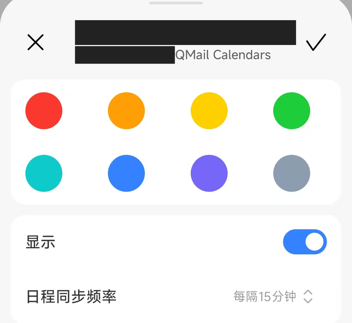

# 红米手机同步 QQ 邮箱日历

本文记录一次红米手机的实际配置过程：Skill 已通过 CalDAV 写入 QQ 邮箱日历，手机最初没有显示日程，改用系统日历的 **Caldav 账号**入口后成功显示。

验证日期为 2026-11-02。未记录具体机型、系统版本和日历应用版本，因此下列菜单仅以本次截图为准，不代表所有 MIUI / HyperOS 版本。截图已裁剪并遮挡账号等个人信息。

## 先区分云端写入与手机同步

```text
QQ 邮件 ── IMAP ──> Skill 提取事项
                         │
                       CalDAV
                         ↓
                   QQ 邮箱云端日历
                         │
                       CalDAV
                         ↓
                    手机日历应用
```

Skill 写入成功，只能证明 QQ 云端保存了日程，不能证明手机已经拉取并显示。手机需要另行添加同一个 QQ 账号的 CalDAV 日历。电脑上重新写入日程不会修复手机的账号类型或显示设置。

可先在已安装的 Skill 目录执行：

```bash
node scripts/mailcal.mjs config test
node scripts/mailcal.mjs calendar list
node scripts/mailcal.mjs calendar events --start 2026-11-01 --end 2026-11-05
```

查询日期应替换为实际日程所在范围，结束日期不包含在内。只有服务器中确实没有目标日程时，才需要排查创建过程；不要为了测试手机同步反复创建不同 UID 的同一事项。

## 从日历的 CalDAV 入口添加

1. 打开手机的**日历**，进入**日程账号管理 → 导入账号**。
2. 选择列表底部的 **Caldav 账号**，不要选择“邮箱”。本次界面的说明文字为“支持 iCloud 等 CalDav 账号导入日程”，但并不表示只能连接 iCloud。
3. 填写 QQ 邮箱账号和客户端授权码，连接后启用目标日历的显示。



| 字段 | QQ 日历配置 |
| --- | --- |
| 用户名 | 完整的 QQ 邮箱地址，例如 `person@qq.com` |
| 密码 | QQ 邮箱客户端授权码，不是 QQ 登录密码 |
| 服务器（仅主机名） | `dav.qq.com` |
| URL（要求完整地址时） | `https://dav.qq.com/` |
| 端口（如有） | `443` |
| SSL / TLS（如有） | 开启 |

字段名称以实际界面为准，不需要把上述所有项目都填写一遍。授权码应只在本机输入，不要贴到聊天、Issue 或 PR 中。

添加后，先选择与 Skill 配置中 `calendar.collection_url` 对应的日历，再去目标日期检查标题、时间和面试链接。本次 Skill 写入的是名为“日历”的集合；每个账号的集合 URL 不同，应使用自己 `calendar list` 的结果，不要复制他人的地址。

## 有“同步日历”开关，为什么仍然不显示？

本次排查中，邮箱客户端提供了“同步日历”开关，但进入服务器设置后，账号类型实际是 **Exchange**。把 `dav.qq.com` 填入 Exchange 服务器栏，不能将该账号变成 CalDAV 账号。两者即使都使用 HTTPS / 443 端口，也不是同一种协议。



同样，POP3、IMAP 是收取邮件的协议，不能用这些选项代替 CalDAV。遇到“账户重复”时，只能说明该添加入口检测到已有账号，不能据此认定 QQ 日历已连接。

建议按顺序检查：

1. 云端是否有目标日程：用 `calendar events` 或 `calendar get` 只读核实。
2. 手机是否从 **Caldav 账号**入口添加，而非 Exchange 或 IMAP。
3. 登录的完整邮箱是否一致，授权码是否有效。
4. 对应日历是否开启显示，最近一次同步是否成功。
5. 目标日期、时区是否正确。

如果当前版本没有 CalDAV 入口，再考虑使用支持 CalDAV 的同步工具。不要仅因“邮箱”入口中没有 CalDAV，就断定红米系统日历不支持它。也不要为解决显示问题直接清除本地日历数据。

## 同一日程出现两份

本次成功连接后，手机为同一个 QQ 邮箱列出了多个来源：

- `<账号>'s QQMail Calendars`
- `Tasks`
- `好友生日`
- `日历`

这些名称是同一账号下发现的不同日历来源，不应仅因邮箱地址相同就判定为重复添加账号。



本次手机中，面试和测试日程均出现两份。服务器查询在 Skill 选择的“日历”集合内只返回一份对应 UID，因此可先排查多个来源是否显示了同一事项；这还不足以排除其他集合存在副本。

可以尝试以下可逆的显示排查：

1. 在“日程账号管理”点开 `<账号>'s QQMail Calendars`。
2. 关闭**显示**，点击右上角 **✓** 保存。
3. 保留与 Skill 目标集合对应的“日历”显示，再检查重复项是否消失。



截图确认了该“显示”开关和同步频率设置的存在；本次记录尚未获得关闭开关后消除重复的反馈，因此这里是排查步骤，不是已验证的根因或修复结论。若仍重复，比较两条日程详情中的来源，再核实各集合的 UID 和资源地址。先关闭显示，不要直接删除日程，以免删除云端原始事件。

手机按自己的同步频率拉取 QQ 日历，不一定即时更新；截图中的频率为每 15 分钟，也可使用界面的“刷新”。这只同步云端日程，**不会让 Skill 自动扫描新邮件**，后者仍需要主动运行或另行配置自动化。

## 分享排障截图前

- 裁掉通知、状态栏、媒体浮窗和无关应用信息。
- 使用实心遮挡去除邮箱、QQ / 小米账号、姓名、电话等信息；不要只用可逆的覆盖层。
- 不展示密码或授权码输入框、凭据文件、私人面试链接、日历集合中的私有标识和邮件正文。
- 日程标题、岗位、时间及联系人也可能透露求职经历；本页只保留配置界面，没有发布面试列表。
- 仅提交脱敏后的导出图片，不把原图、缓存或含私人信息的文件名加入 Git。
